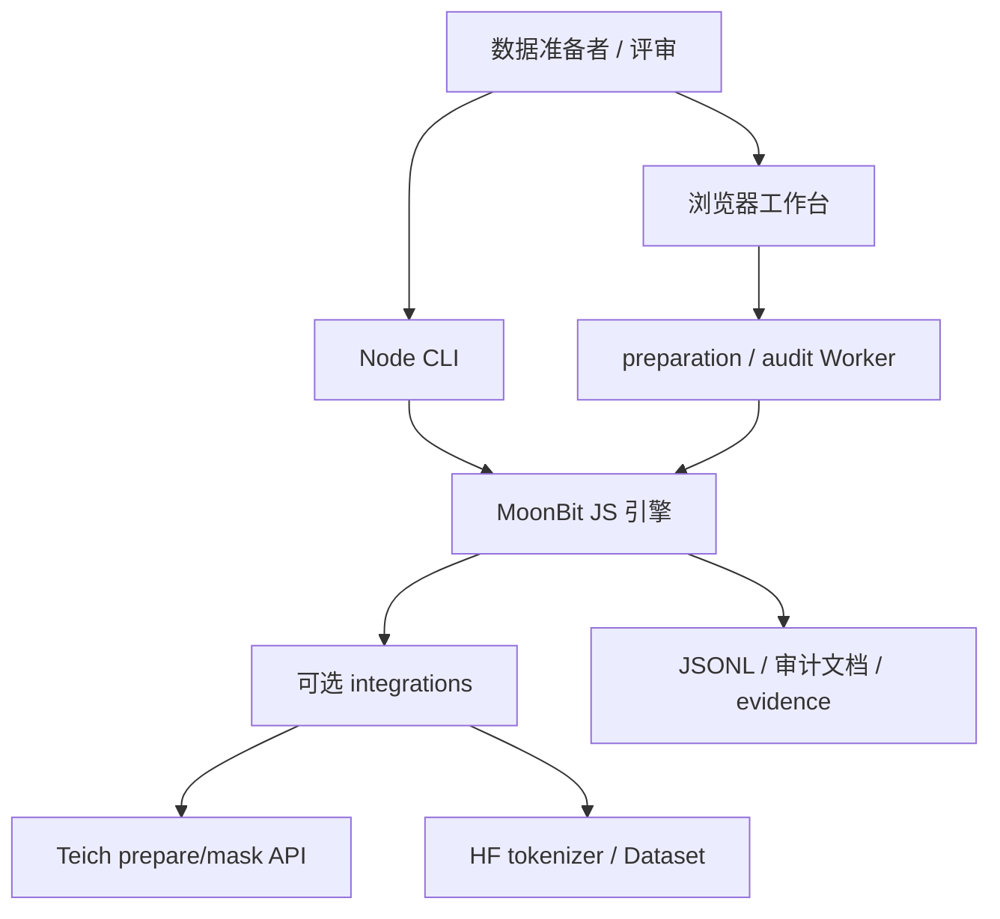
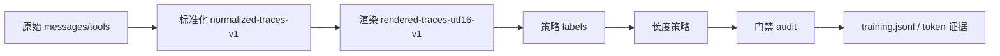
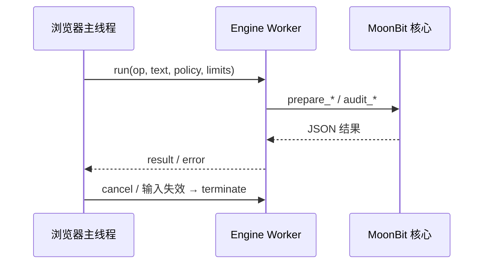

# 架构说明书

SupervisionAudit 是以 MoonBit 为核心的**训练数据准备与监督验证工作台**。判定在 MoonBit；JavaScript 只做 I/O、Worker 编排与呈现。

## 1. 系统上下文

外部系统可选、可替换；缺省路径用仓库内冻结 rendered 夹具离线跑通。

## 2. 逻辑分层

| 层 | 代码位置 | 职责 | 非职责 |
| --- | --- | --- | --- |
| 准备合同 | `preparation/` | 轨迹校验、六类策略、序列长度、准备报告 | agent 执行、下载词表、训练 |
| 审计合同 | 根包 `audit*.mbt` | unshifted 标签、Padding/拼接/角色泄漏、比较 | 推断缺失 provenance |
| 呈现 | `web/*` | 静态页、表单、导出、演示夹具 | 改写判定 |
| 桥接 | `cli.mjs` / `prepare.mjs` / Workers | 读入写出、取消、任务版本 | 业务规则 |
| 适配 | `integrations/` | Teich/HF 调用与说明 | 复制 Teich 标签实现 |

## 3. 运行时双路径

- **浏览器：** 每次任务独立 Worker；取消或输入变化终止旧任务，防止过期结果覆盖。
- **CLI：** 同进程直接调用编译后的 JS 引擎；退出码区分 pass / fail / review。
- **CI：** Linux 上 `moon build` 生成引擎；Windows 本机可能遇 moonc 路径 ICE，以 Actions 为准。
- **策略预设对比：** 准备页对清单内每个预设依次调用同一 `prepare` 接口（不同 `policy`，同一 rendered 文本与长度设置）。只做展示摘要，不引入第二套 masking，也不改当前勾选或已有导出。
- **门禁页下一步条：** `/audit.html` 的 `#audit-next` 只根据已有 `report.status` 给出导出/回准备/看问题入口，不改变审计结论。

## 4. 合同清单

| 合同 / schema | 用途 |
| --- | --- |
| `causal-lm-unshifted-v1` | `labels[i] ∈ {input_ids[i], -100}` |
| `normalized-traces-v1` | 校验后的 messages/tools |
| `rendered-traces-utf16-v1` | 模板文本 + UTF-16 offsets + typed candidates |
| `template_family` | `chatml-typed-v1` \| `zephyr-typed-v1`（来源声明，标签算法同源） |
| `supervision-audit/mix-v1` | 多源显式 `take` + `seed` |
| `supervision-audit/policy-presets/v1` | 准备页策略预设清单 |
| `supervision-audit/reviewer-demo/v1` | 离线评审证据 |
| `supervision-audit/registration-facts/v1` | 可引用事实卡（非报名终稿） |

长度策略：`reject`（默认）/ `truncate-right` / `truncate-complete-turns`（对标 Teich `trim_followups` 意图，不重分词）。

## 5. 信任与失败模式

| 情况 | 行为 |
| --- | --- |
| 缺角色/来源证据 | `review` / unknown，不补造 |
| 超长且 `reject` | 整批拒绝导出 |
| 完整轮次切到回答中间 | 整批拒绝 |
| 截断后无有效目标 | 整批拒绝 |
| Worker 取消 | 丢弃结果，界面回到待运行 |
| Teich 未安装 | 仍可用冻结 rendered + 冻结对照记录 |

不自动修复用户数据；报告只诊断。

## 6. 已实现 vs 明确未做

**已实现：** `/` → `/prepare.html` → `/audit.html`；策略预设与预设目标数对比；Zephyr 族演示；mix 冻结演示；长度一键演示；`demo:reviewer` / `facts:registration`；Teich 固定提交对照；三后端测试。

**未做：** 生产 tokenizer 全覆盖、超大 JSONL 流式、外部真实试用记录、宣称模型效果、代写报名终稿。

准备合同细节见 [training-preparation.md](training-preparation.md)；产品口径见 [PRODUCT.md](PRODUCT.md)；评审入口见 [REVIEWER_PACK.md](REVIEWER_PACK.md)。
