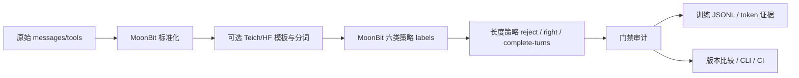

# 架构与迭代路线

SupervisionAudit 是**训练数据准备与监督验证工作台**。MoonBit 拥有全部审计/标签判定；JavaScript 仅 I/O、Worker 编排与呈现。

## 包边界

| 层 | 职责 | 非职责 |
| --- | --- | --- |
| `preparation/` | 轨迹校验、策略 labels、序列长度、准备门禁报告 | 不执行 agent、不下载 Hub 词表、不训练模型 |
| 根包审计核心 | unshifted 合同、Padding/拼接/角色泄漏、修复比较 | 不推断缺失 provenance |
| JS / 浏览器 | 静态页、Worker、文件导入导出、演示夹具 | 不改写判定结果 |
| `integrations/` | 可选 Teich/HF 渲染与 Dataset 加载说明 | 不复制 Teich 标签实现 |

合同：`causal-lm-unshifted-v1`；`labels[i]` 为 `input_ids[i]` 或 `-100`。`template_family`（`chatml-typed-v1` \| `zephyr-typed-v1`）只声明渲染来源，标签算法同源。

## 设计决定

审计与标签核心不用大模型判断。JSONL 缺元数据时返回未知，不把缺省角色推断成助手。报告不改写输入，不自动修复用户数据。浏览器经 Worker 调用编译后的 MoonBit；取消或输入失效时终止旧任务。CLI 调用同一核心。

## 已实现（过审可核对）

- 产品入口 `/` → 准备 `/prepare.html` → 门禁 `/audit.html`
- 策略预设、完整轮次截断、多源 `mix-traces`、`demo:reviewer`、`facts:registration`
- Teich 固定提交对照（labels 一致 / 空目标双方拒绝 / 故障门禁）
- 三后端 MoonBit 测试 + Node 桥接测试；远端 Actions 为准

## 下一步（明确未做）

- 生产 tokenizer / 多模板全覆盖端到端训练适配
- 超大 JSONL 流式审计与批量性能基准
- 外部真实用户试用记录（不虚构）
- 官方报名终稿（须本人撰写）

详细准备合同见 [training-preparation.md](training-preparation.md)；过审定位见 [PRODUCT.md](PRODUCT.md)。
