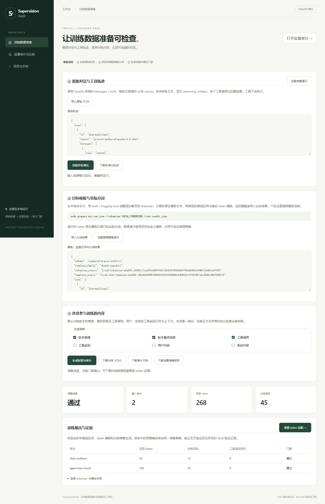

# Training data preparation / 训练数据准备

2026-10-13 新增实现：原始对话与工具轨迹 → 标准化 → 原生模板与分词 → 按类型生成标签 → 审计门禁 → 训练 JSONL。MoonBit 实现标准化校验、监督选择、标签生成和审计；可选 Python 层调用固定版本 Teich 与 HF，提供模板文字、候选区间和实际 token 偏移。

新增核心包为 `FidollarinLA/supervision_audit/preparation`，报告使用 supervision-audit-report-v2；已发布的根包 v1 类型与命令行管道保留。准备文档应通过 `prepared-audit.mjs` 执行完整预期目标门禁，浏览器也按所供预期证据调用新包。原始根包 `cli.mjs` 的 v1 数据合同继续独立使用，不能把它对未知扩展字段的忽略当作预期目标验证。

## 离线使用

```sh
node scripts/build.mjs
node prepare.mjs examples/traces/raw.json --normalize
node prepare.mjs examples/traces/qwen-rendered.json --rendered --out preparation.json
node prepare.mjs examples/traces/qwen-rendered.json --rendered --emit document --out audit-document.json
node prepare.mjs examples/traces/qwen-rendered.json --rendered --emit jsonl --out training.jsonl
node prepare.mjs examples/traces/qwen-rendered.json --rendered --policy examples/traces/final-only.json --out final-only-result.json
```

默认演示：2 条样本、268 个实际 Qwen token、45 个有效目标，工具返回目标为 0。final-only 策略保留 24 个目标。这些是项目原创的小型对话，不是生产语料或用户收益实验。

运行静态服务器后打开 `/prepare.html`。可以导入原始 JSON 做校验、导入实际分词结果、用策略预设下拉一键套用 `assistant-all` / `final-only` / `tools-and-answers`（或手改六类勾选回落「自定义」）、导出报告/文档/训练 JSONL；“查看 token 证据”通过同一浏览器标签页临时传递审计文档，审计页读取后删除暂存。没有上传接口。大任务在可取消 Worker 中执行，编辑输入或改变策略清除旧结果。

## 训练序列上限（2026-10-18 / 2026-10-21）

新增 `prepare_training_json(rendered, policy, limits)` 和可序列化的 `SequenceLimits`，共享原有完整标签准备和审计核心。`limits` 必须明确提供 `max_length`（2–100000 整数）与 `overflow`（`reject`、`truncate-right` 或 `truncate-complete-turns`），拒绝未知字段。旧 `prepare_labels_json` 入口行为保留。

```sh
node prepare.mjs examples/traces/qwen-rendered.json --rendered --max-length 192
node prepare.mjs examples/traces/qwen-rendered.json --rendered --max-length 192 --overflow truncate-right --out length-report.json
node prepare.mjs examples/traces/qwen-rendered.json --rendered --max-length 192 --overflow truncate-right --emit jsonl --out training.jsonl
node prepare.mjs examples/traces/qwen-rendered.json --rendered --max-length 180 --overflow truncate-complete-turns --emit jsonl --out turns.jsonl
```

第一条命令因工具轨迹为 216 token 而拒绝。右截断保留 192 token 左侧前缀；总训练目标由 45 减为 33，移除 24 token / 12 目标。`truncate-complete-turns` 只在助手/文本 span 边界截断，去掉装不下的后续轮，对标 Teich `oversized_policy="trim_followups"` 的意图；若上限落在回答中间则整批拒绝，不会悄悄改成右截断。完整准备报告的 `sequence_summary` 提供逐行前后数量与 `boundary` 说明。

实现先校验完整输入，包括会被移除的尾部，之后才截断。超长默认拒绝；空目标拒绝整批、不静默丢行，也不会覆盖已有训练文件。未实现左截断、自动补 EOS、padding、packing 或重分词。标准训练 JSONL 仅含 id/input_ids/labels/attention_mask。

网页同样提供长度与超长处理选项，修改任一项会取消旧任务、使旧下载和 token 证据失效。未填长度时不能只选择截断策略。

## 多源混合与训练接入（2026-10-21）

```sh
node scripts/mix-traces.mjs examples/traces/mix-demo.json --out mixed-rendered.json
node prepare.mjs mixed-rendered.json --rendered --emit jsonl --out mixed-training.jsonl
python integrations/transformers/load_prepared_jsonl.py mixed-training.jsonl
```

`mix-traces` 按显式 `take` 条数合成多份已有轨迹，固定 `seed` 可复现；不下载 Hub、不生成 agent 数据。`load_prepared_jsonl.py` 校验 unshifted 合同后可输出 Hugging Face `Dataset` 信息，供 `SFTTrainer` 在 `packing=False` 下直接使用已门禁 labels，无需再做 response-only masking。

## 自己的原始数据

原始输入为 `{"rows":[{"id":"...","source":"...","messages":[...],"tools":[...]}]}`。`tools` 可以省略。角色支持 system、user、assistant、tool；content 为文本；助手可提供 reasoning_content 和 tool_calls。函数 arguments 接受 JSON 对象或可解码为对象的 JSON 字符串。每个调用需要唯一 ID，结果用 tool_call_id 配对；支持多个待处理调用及其结果。来源由调用者声明，不认证真实性。

安装可选依赖并准备本地 tokenizer（只需 tokenizer.json、tokenizer_config.json，不需要模型权重）：

```sh
python -m venv .venv
# 激活该虚拟环境；Windows 使用 .venv\Scripts\Activate.ps1
python -m pip install -r integrations/teich/requirements.txt
python integrations/teich/fetch_tokenizer.py
node prepare.mjs examples/traces/raw.json --tokenizer .local/sft-data --out preparation.json
node prepare.mjs examples/traces/raw.json --tokenizer .local/sft-data --emit jsonl --out training.jsonl
```

`--python` 可指定 Python 可执行文件。开发时 `--teich-source` 可指定固定提交源码的根目录；适配层会逐文件核对 [reference-lock.json](../integrations/teich/reference-lock.json) 中的 Git blob SHA，拒绝与固定版本不同的源码。依赖安装与首次 tokenizer 下载需要网络，之后渲染过程强制本地加载。

模板支持范围为 ChatML 的 typed span 合同，本轮实际验证 Qwen2.5-0.5B-Instruct 的固定原生模板。Qwen2 模板会省略显式 reasoning_content，因此适配层拒绝此组合；推理策略用项目自定义 ChatML 模板和真实 HF WordLevel tokenizer 单独验证。没有据此声称支持全部模型或全部 Teich 模板。

## 字符与监督合同

渲染输入：`rendered-traces-utf16-v1`，`template_family` 为 `chatml-typed-v1` 或 `zephyr-typed-v1`（族名只作来源声明，标签算法相同），明确 tokenizer_source/template_source，以及 rows。每行提供 id、source、text、input_ids、attention_mask、offsets、candidates。Python 的 Unicode codepoint 偏移转换为 UTF-16 code units；JS/Wasm/native 都使用同一合同。准备页「Zephyr 风格演示」为项目自写 WordLevel 样例，不冒称 Hub 实装词表。

CandidateSpan 的 start/end 是可训练候选区间，source_start/source_end 是真实字段正文区间，kind 必须是 reasoning、final_answer、tool_call、tool_response、user 或 system，且 role 必须匹配。策略先合并启用候选，再排除关闭类别的正文和声明的 think/tool_call/tool_response 包装。只有完全位于选中字符区间的 token 才获得自身 token ID 标签；跨越范围边界、Padding、零长度偏移和位置 0 设为 -100。未知 kind、非法偏移、冲突角色及空有效目标会拒绝整个请求，不静默丢行。

报告中的 expected_supervision 根据同一份候选区间与策略生成，用于检查后续 collator 是否改变训练目标；它不是独立参考，也不认证模板或来源。独立的标签实现对照见下一节。

资源边界：原始输入 1,048,576 UTF-16 units、每批 1–200 行、每行 1–200 条消息；渲染输入 4,194,304 units，每批最多 100,000 token / 262,144 文本 units / 2,000,000 区间与偏移字符访问，每行最多 2,000 候选。CLI 文件读入另有 4 MiB 字节上限，渲染子进程有 120 秒及 16 MiB 输出上限。输出不能覆盖原始输入、策略文件或 tokenizer 两个输入文件及其文件别名。

不接受多模态内容、developer 角色、原生 agent 事件格式、消息中的未声明字段或嵌入协议控制标记；这些需要独立适配与转义合同。函数校验涵盖声明名称、对象 arguments、required 参数存在性和 ID 配对，不是完整 JSON Schema 类型验证。Teich 适配层另执行其官方工具校验。无需执行工具、生成 agent 轨迹、模型训练或托管服务。

## Teich 实际交叉验证

对标固定 [Teich 提交 609412f](https://github.com/TeichAI/teich/tree/609412fcb5649268b6de3f789fc0d59c4dce0585)。Teich 格式化候选区间由双方共享；MoonBit `prepare_labels_json` 与 Teich 公开 `mask_data` 是两个实际运行的标签实现。未复制 Teich 标签代码，也不称这项验证是完全独立的端到端格式化实现。

```sh
python integrations/teich/verify.py
node --test test/preparation.test.mjs
node scripts/verify-preparation-browser.mjs
```

本机结果：[机器记录](measurements/teich-preparation-2026-10-13.json)，32 项检查 = 23 组逐 token labels 一致 + 7 组双方拒绝空有效目标 + 2 个故障注入门禁。包含助手全部、最终回答、工具调用、推理、助手与工具返回、全角色六策略；普通多轮对话/工具调用用实际 Qwen 模板，显式推理用自定义模板。两个故障是项目主动修改 collator labels，将工具返回误设为目标，MoonBit 返回 fail；不是声称 Teich 存在故障。

真实 Teich 输出已保存为 [冻结标签参考](../examples/traces/teich-label-reference.json)，普通 Node 测试无需安装 Python/Teich。生成参考的脚本、源码锁、tokenizer 校验和原始输入均在库中；`--refresh-fixtures` 仅用于显式刷新。CI 配置重新运行实时 Teich API 对照并核对冻结输出，远端结果需看对应提交实际运行。

最新主分支整合后，本机核心 JS/Wasm GC/native 合计各 54 项（既有 26 + preparation 28）通过。Node 全量 63 项全部通过，包括原有 stdin/CLI 与全部新增准备测试。实际打包 128 个公开归档文件，独立消费者三个后端各 4 项通过，包含 preparation 类型/调用验证。源码未正式发布。Edge 8 项流程检查无页面错误，包含下载与核心等值、策略失效、一键证据页、空目标/坏 UTF-8 拒绝、1440/390 布局。[浏览器机器记录](measurements/preparation-browser-2026-10-13.json)。这些是本机工程证据，未声称外部用户试用或正式赛事验收。


